<div align="center">


# diffwalker

**An agentic code reviewer for your local git repositories, with a Copilot that drives the UI in front of you.**

Point it at a repo. It finds the pull requests (local branches, open GitHub PRs, uncommitted work), reviews each one through an eight-stage pipeline of deterministic analysis and typed LLM calls, anchors every finding to a line of the diff, and lets an agent do anything you can do in the app while you watch.

[](LICENSE)
[](https://github.com/marsninja/neojac)
[](#configuration)
[](#four-apps-one-codebase)

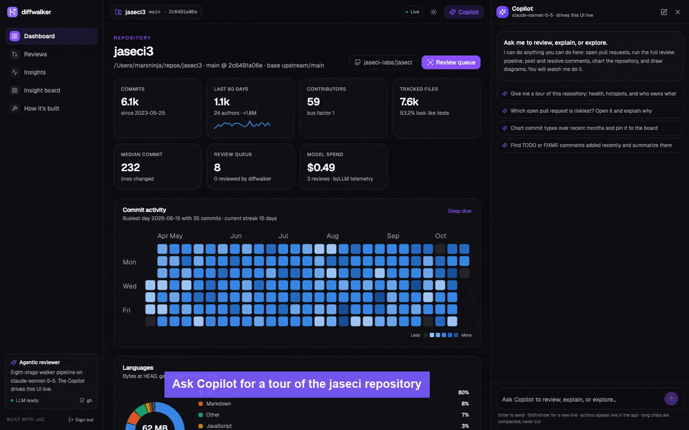

<sub>One continuous take, sped up: Copilot tours the <a href="https://github.com/jaseci-labs/jaseci">jaseci</a> repository, pins a hotspot chart, then switches to a demo repo, runs a full review live and lands on the critical finding. <a href="docs/media/diffwalker-demo.mp4">MP4 version</a>.</sub>

</div>

---

## Contents

- [Highlights](#highlights)
- [Quick start](#quick-start)
- [Tour](#tour)
  - [Reviews that stream as they happen](#reviews-that-stream-as-they-happen)
  - [Findings anchored to the diff](#findings-anchored-to-the-diff)
  - [A Copilot that shares your screen](#a-copilot-that-shares-your-screen)
  - [Repository insights](#repository-insights)
  - [Insight board](#insight-board)
  - [Mobile app](#mobile-app)
  - [Desktop app](#desktop-app)
  - [Command line](#command-line)
  - ["How it's built" page](#how-its-built-page)
- [How a review works](#how-a-review-works)
- [How the Copilot works](#how-the-copilot-works)
- [Four apps, one codebase](#four-apps-one-codebase)
- [Configuration](#configuration)
- [Project layout](#project-layout)
- [Notes on the neojac toolchain](#notes-on-the-neojac-toolchain)
- [License](#license)

## Highlights

- **Reviews any local repo.** Local branches ahead of base, open GitHub PRs via `gh`, and your uncommitted worktree all show up as reviewable pull requests.
- **Eight-stage agentic pipeline.** Ingest, deterministic risk triage, planning, a specialist reviewer per file with code-search tools, cross-file analysis, context investigation, adversarial verification, and synthesis. The verifier throws out false positives before you see them.
- **Every finding lands on a line.** Severity, category, confidence, the verifier's reasoning, a suggested change, and Resolve / Dismiss / Reply / Ask Copilot actions, inline in the diff.
- **A Copilot that drives the UI.** 29 tools: it navigates, opens pull requests, scrolls to code, runs reviews, posts and resolves comments, renders charts and Mermaid diagrams, and pins them to a board, all live on your screen. Publishing to GitHub always waits for your click.
- **Repository analytics.** Commit heatmap, weekly volume and churn, commit-type mix, hotspot scatter, contributors and ownership (with knowledge-silo warnings), a treemap of the codebase, and a temporal-coupling network.
- **Spend you can see.** Every review is metered per stage, and every Copilot turn as a whole, from the token counts the model API reports. The UI and the CLI show it, and a budget caps it.
- **Web, desktop, mobile, and CLI.** One codebase, four apps. The desktop app is one program that runs the whole thing on your computer or connects to a diffwalker server, your choice at launch. The mobile app is React Native, and the same component is embedded live in the web app. The CLI can drive your open browser.
- **Private per account.** Every endpoint is authenticated, and each user's reviews, Copilot threads, board, and active repository live in their own graph.

## Quick start

You need [neojac](https://github.com/marsninja/neojac), `git`, and an Anthropic API key. [`gh`](https://cli.github.com) is optional; with it, open GitHub PRs appear in the queue. neojac brings its own Node and npm, so the web app and the CLI need nothing else.

Install neojac (Linux x86_64 or arm64, macOS on Apple Silicon):

```bash
curl -fsSL https://github.com/jaseci-labs/neojac-releases/releases/latest/download/install.sh | bash
```

diffwalker needs the neojac features that [DOGFOOD.md](DOGFOOD.md) lists. Until a neojac release has them, build neojac from the `diffwalker-compat` branch of its repository (`sh scripts/build.sh` there makes `build/bin/neojac`).

```bash
git clone https://github.com/marsninja/diffwalker
cd diffwalker
echo 'ANTHROPIC_API_KEY=sk-ant-...' > .env     # gitignored; read at startup
neojac install                                  # npm packages for the site and the phone app; the Android SDK
DIFFWALKER_REPO=/path/to/any/git/repo neojac run web
```

`neojac run web` builds the web app and runs it. It prints `listening on http://127.0.0.1:8000/` (`JAC_WEB_LISTEN=host:port` changes the address). Open it, create an account, and you are looking at your repository. Switch repositories any time from the top bar, or ask Copilot to.

The server keeps its accounts and each user's graph under `.jac/data/web` in the project (`JAC_WEB_DATA` moves it). `neojac run web --fresh` sets that data aside and starts empty. While working on the app, `neojac dev web` rebuilds on every save.

Defects and gaps in neojac that diffwalker runs into are fixed in neojac rather than worked around here (see [AGENTS.md](AGENTS.md) and [DOGFOOD.md](DOGFOOD.md)).

### Try the demo repository

The screenshots below use a small payments service whose `feat/refunds` branch contains real bugs. Build it yourself:

```bash
docs/demo/make-demo-repo.sh ~/payments-demo
DIFFWALKER_REPO=~/payments-demo neojac run web   # then review the refunds branch
```

## Tour

### Reviews that stream as they happen

Start a review from the queue, the pull request page, the phone, the CLI, or by asking Copilot. Each of the eight stages lights up as it finishes, with what it did; reviewer activity streams in below (drafts, files as they are reviewed, and the verifier's rejections with its reasons).

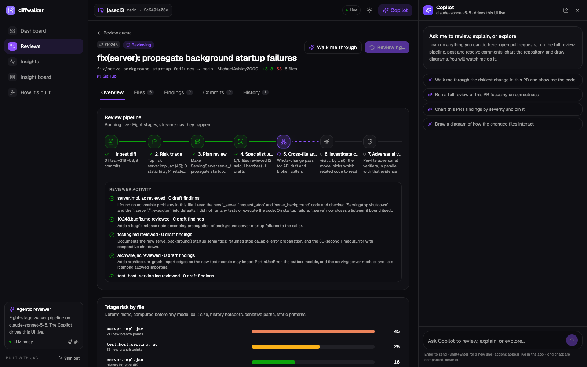

When it completes you get a verdict, a merge-risk gauge, the review's intent and summary, concerns, what was done well, suggested tests, and a per-file walkthrough, plus exactly what the review cost.

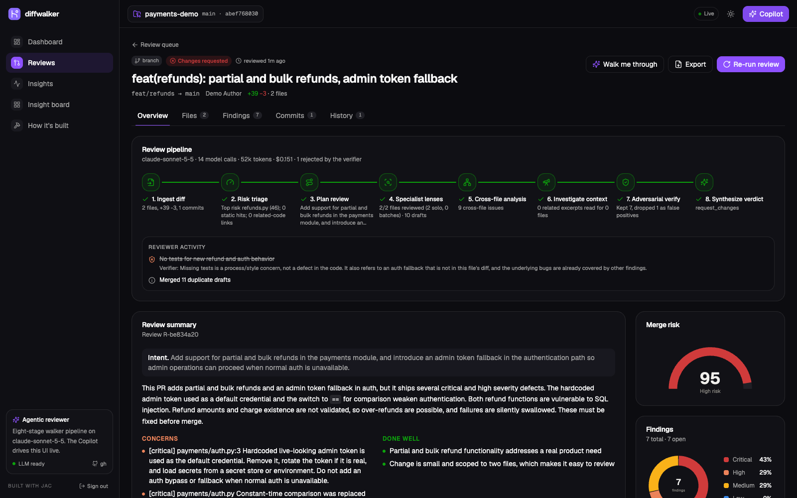

### Findings anchored to the diff

Findings sit under the line they are about, in a GitHub-style diff with old and new line numbers. Hover any line and press **+** to add your own comment.

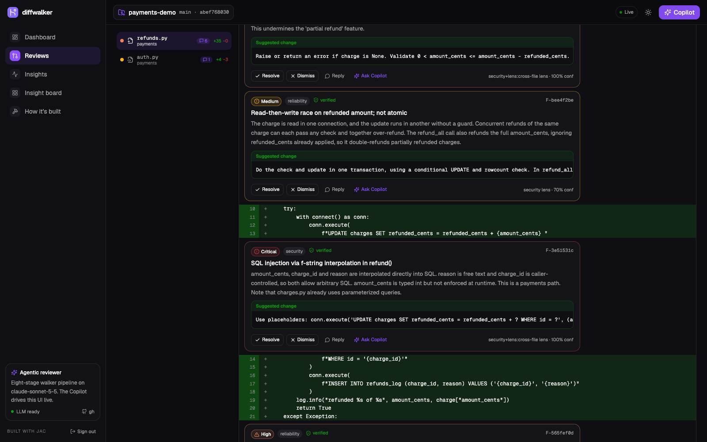

The Findings tab gathers them with severity, category, and status filters. Copilot can set those filters too.

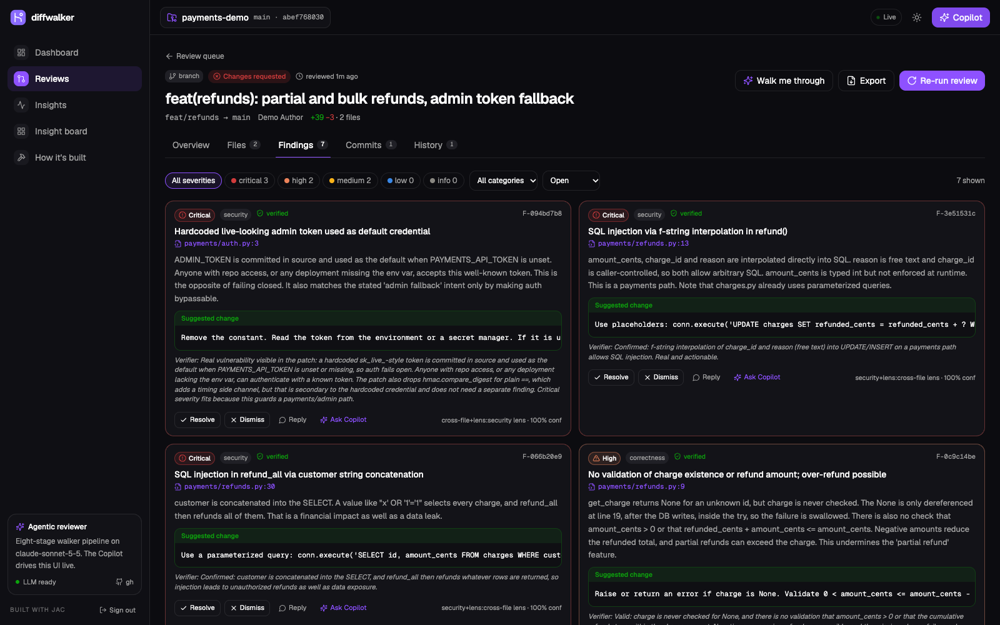

### A Copilot that shares your screen

Ask in plain language. Copilot works through the same actions the buttons use, and every action is visible: chips for each tool call, the screen moving as it navigates, cards for anything it renders.

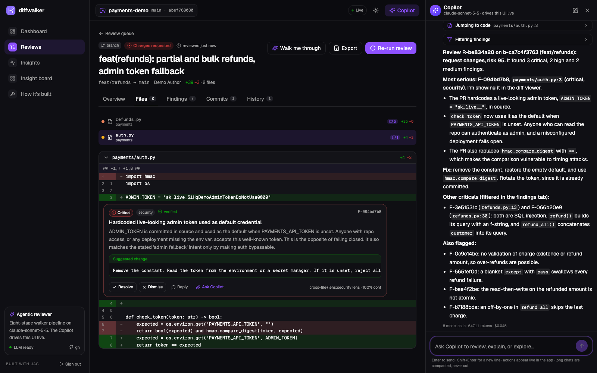

<table>
<tr>
<td width="50%">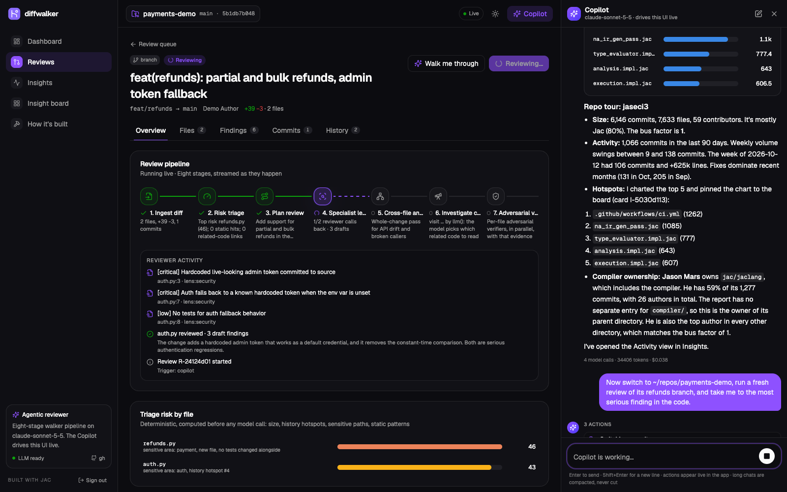</td>
<td width="50%">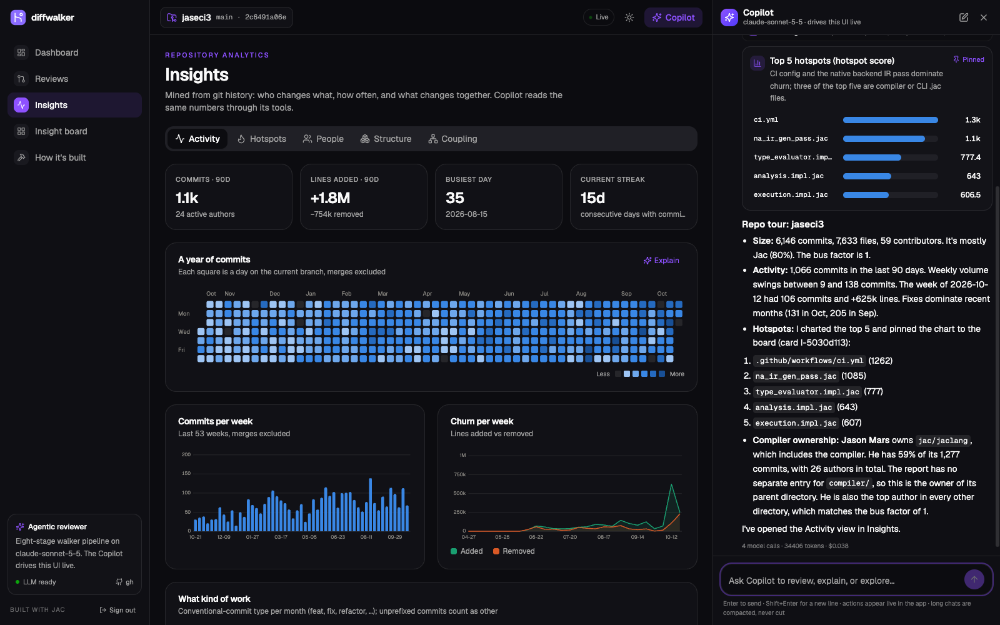</td>
</tr>
<tr>
<td><sub>"Review the refunds branch": Copilot starts the pipeline and the drafts stream in.</sub></td>
<td><sub>"Give me a quick tour": Copilot opens the analytics and renders a chart from real numbers.</sub></td>
</tr>
</table>

A turn can be stopped (it ends after the step it is on), a long conversation keeps its most recent turns, and each turn has its own spending cap.

### Repository insights

Everything is mined from git history and cached per `HEAD`. Copilot reads the same numbers through its tools, so its answers match the charts.

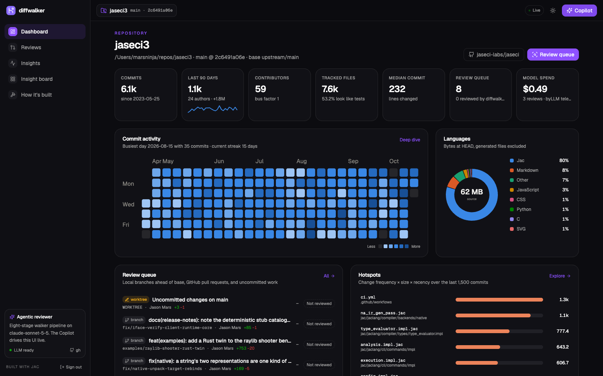

<table>
<tr>
<td width="50%">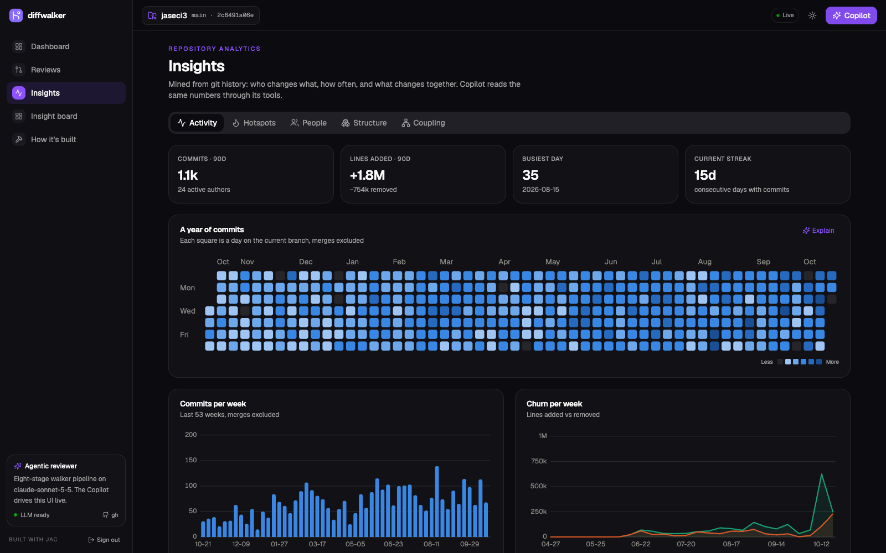<br/><sub><b>Activity</b>: a year of commits, weekly volume, churn, and commit types by month.</sub></td>
<td width="50%">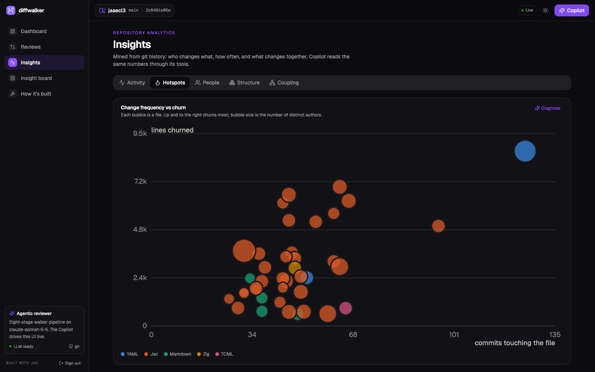<br/><sub><b>Hotspots</b>: change frequency against churn; bubble size is the number of authors.</sub></td>
</tr>
<tr>
<td>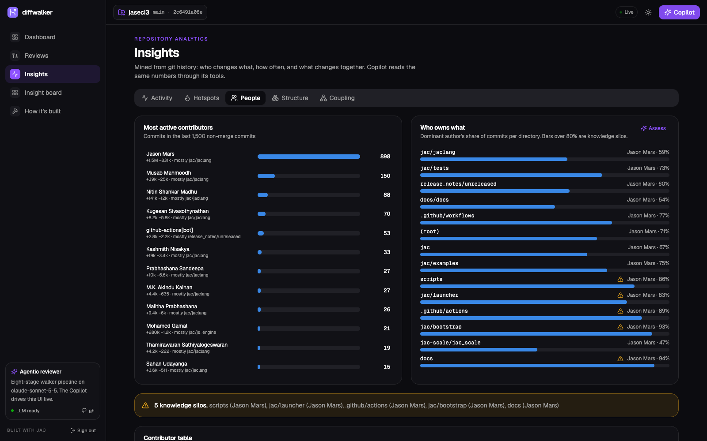<br/><sub><b>People</b>: who works where, and which directories are knowledge silos.</sub></td>
<td>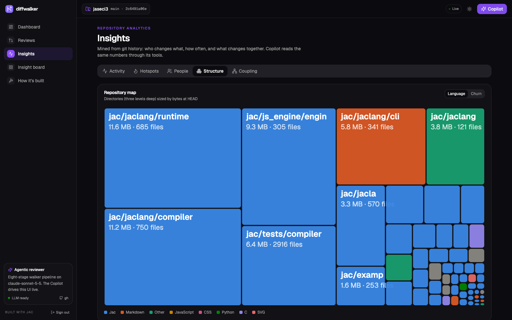<br/><sub><b>Structure</b>: the codebase as a treemap, by language or by churn.</sub></td>
</tr>
<tr>
<td colspan="2">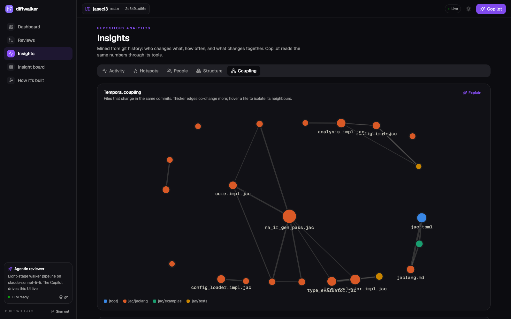<br/><sub><b>Coupling</b>: files that keep changing in the same commits, a map of hidden dependencies.</sub></td>
</tr>
</table>

### Insight board

Charts, tables, and Mermaid diagrams that Copilot renders can be pinned. They are kept under the repository's node in your graph and survive restarts.

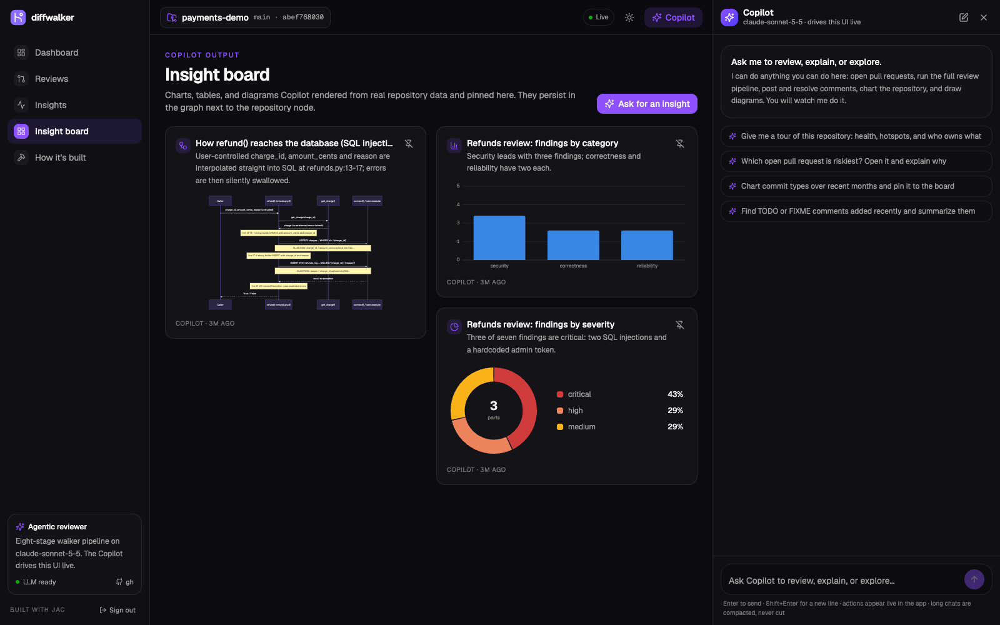

### Mobile app

`mobile/main.jac` is the entry of a React Native app written with the elements of `@jac/mobui` (`View`, `Text`, `Pressable`): sign in, inbox, review with the live pipeline and findings, insights, and its own Copilot, whose navigation moves the phone's tabs. It talks to the same server and the same graph, so resolving a finding on the phone updates the web review.

`neojac build mobile` makes `dist/mobile/mobile.apk`, the app an Android phone installs, beside its Hermes bundles for Android and iOS. `neojac run mobile` installs it on the Android phone that is connected, or on an emulator it starts, and opens it. `neojac dev mobile` serves it to a device through Expo while you work on it.

The Android SDK, a JDK and the emulator are fetched by `neojac install`, into neojac's own cache: `jac.toml`'s `[android]` table asks for them and says the project accepts the SDK's licenses. Remove the table to use the SDK `ANDROID_HOME` names instead. The first build takes a few minutes (Gradle fetches itself, the NDK and React Native's Android libraries); a build with nothing changed runs nothing.

The server the app calls is `[apps.mobile.remote] api` in `jac.toml` (`http://127.0.0.1:8000`), baked into the app. `neojac run mobile` forwards that port from the phone to this machine, so with `neojac run web` running the phone app signs in to it as it is. The app's name and the identifier it is installed under are `[apps.mobile]`'s `name` and `identifier`. An iOS app needs macOS and Xcode (`expo run:ios` in the work directory) and has not been built.

The same component runs in the web app's "How it's built" page. On a phone it keeps clear of the status bar and the navigation bar (`core/native/insets.hermes.jac`, with `react-native-safe-area-context`); in the page it has no bars to keep clear of (`core/native/insets.jac`).

<p align="center">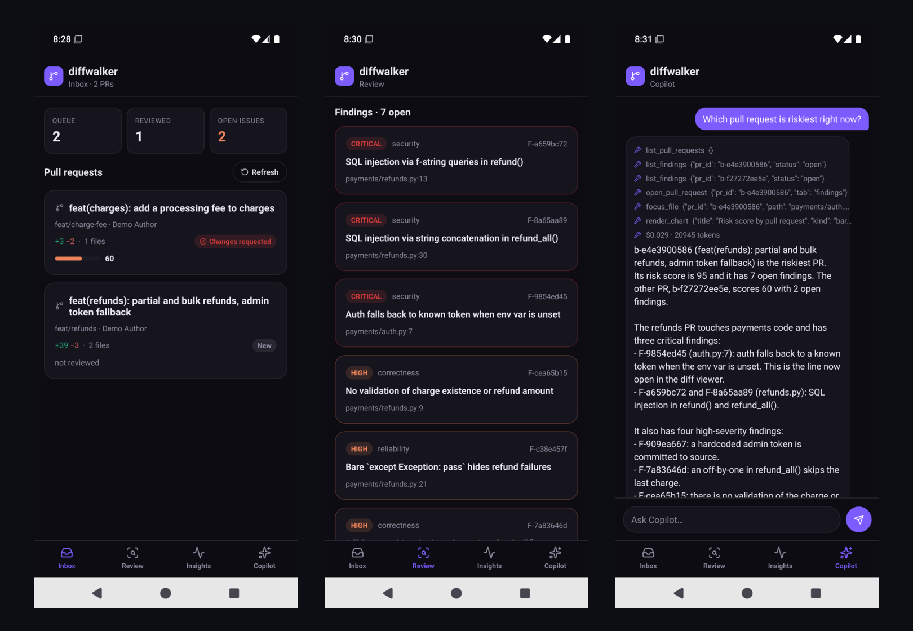</p>

### Desktop app

`neojac run desktop` opens the web app's pages in a native window (the OS webview, no Electron). neojac has a window for Linux only today (GTK 3 with WebKitGTK 4.1); on macOS and Windows the app says so and exits. On first launch it asks how diffwalker should run:

<table>
<tr>
<td width="50%">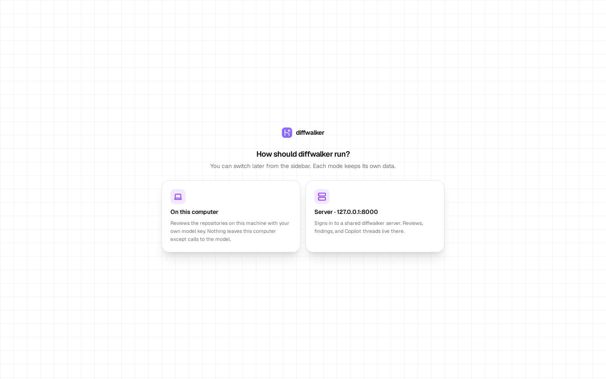</td>
<td width="50%">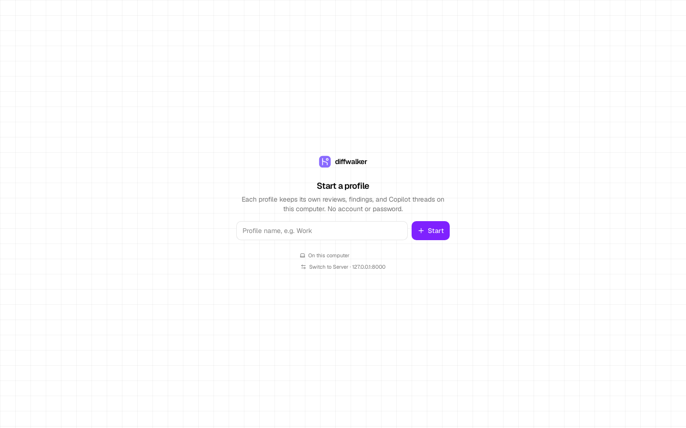</td>
</tr>
</table>

- **On this computer**: diffwalker itself runs in the window's program, keeps its graph in the app's data directory (`.jac/data/desktop` in the project; `JAC_DESKTOP_DATA` moves it), and reviews the repositories on this machine with your model key. It needs no network beyond the model API. There is no account: you pick or start a named profile, like a save slot, and each profile has its own root, so its own reviews, findings, board, and Copilot threads.
- **A diffwalker server**: the app is a window onto a diffwalker server (`neojac run web` on a shared machine). You sign in there, and its reviews and findings are what you see.

Both are one program: `jac.toml`'s `[apps.desktop] profiles = ["default", "local"]` puts the two arrangements in one artifact, and `local_users = true` gives the local one its profiles. The two modes keep separate data. Switch mode or profile from the bottom of the sidebar; switching mode restarts the app in place. The server's address is `[apps.desktop.remote] api` in `jac.toml` (`http://127.0.0.1:8000`), or `JAC_REMOTE_API` where the app runs.

### Command line

The CLI runs the same engine in-process against any repository, with live stage progress, per-stage spend, and an exit code of 1 when changes are requested (useful in hooks and CI). With `--live` it runs on a server instead, and any browser you have open on that server follows along. `login` keeps the session token under `~/.config/diffwalker/`.

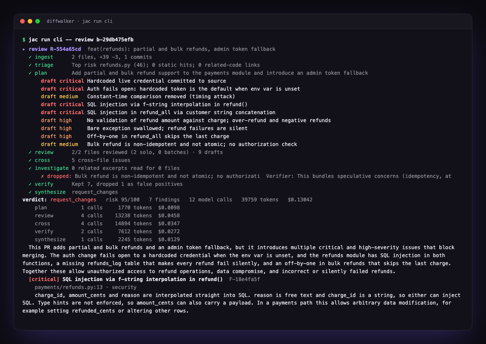

```bash
neojac run cli -- repo                          # headline facts and 90-day stats
neojac run cli -- prs                           # reviewable pull requests
neojac run cli -- hotspots -n 10                # churn hotspots
neojac run cli -- people                        # most active contributors
neojac run cli -- review b-1a2b3c4d5e           # full review, in-process
neojac run cli -- ask "which files churn most, and why?"

neojac run cli -- --server http://localhost:8001 login --user you --register
neojac run cli -- --server http://localhost:8001 review --live b-1a2b3c4d5e
neojac run cli -- --server http://localhost:8001 ask --live "open the riskiest PR"
```

`neojac build cli` makes `dist/cli-<platform>`, one program that takes the same arguments (`dist/cli-linux-x86_64 review b-1a2b3c4d5e`). Without `--server`, a `--live` command calls `DIFFWALKER_URL`, else `[apps.cli.remote] api` in `jac.toml`.

### "How it's built" page

The app documents itself: animated diagrams of the architecture, the persistent graph and the walker that traverses it, the review pipeline, and one Copilot turn step by step, each paired with the real source that implements it, read from the project's files by the running server. The mobile app is embedded in a phone frame on the same page.

<table>
<tr>
<td width="50%">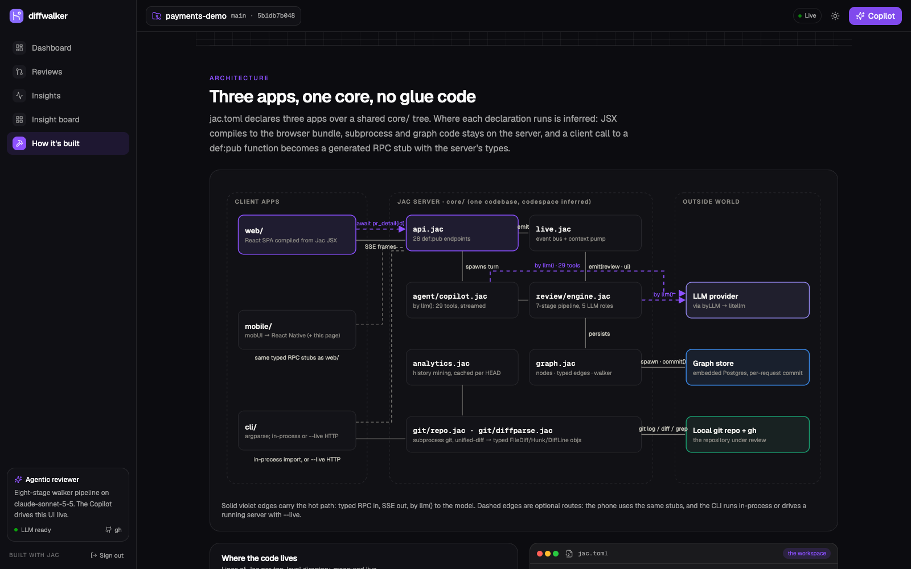</td>
<td width="50%">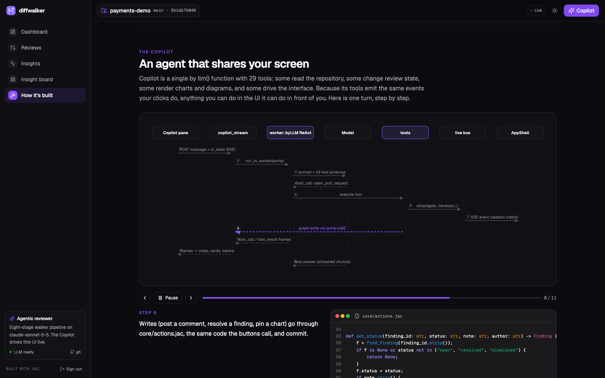</td>
</tr>
<tr>
<td>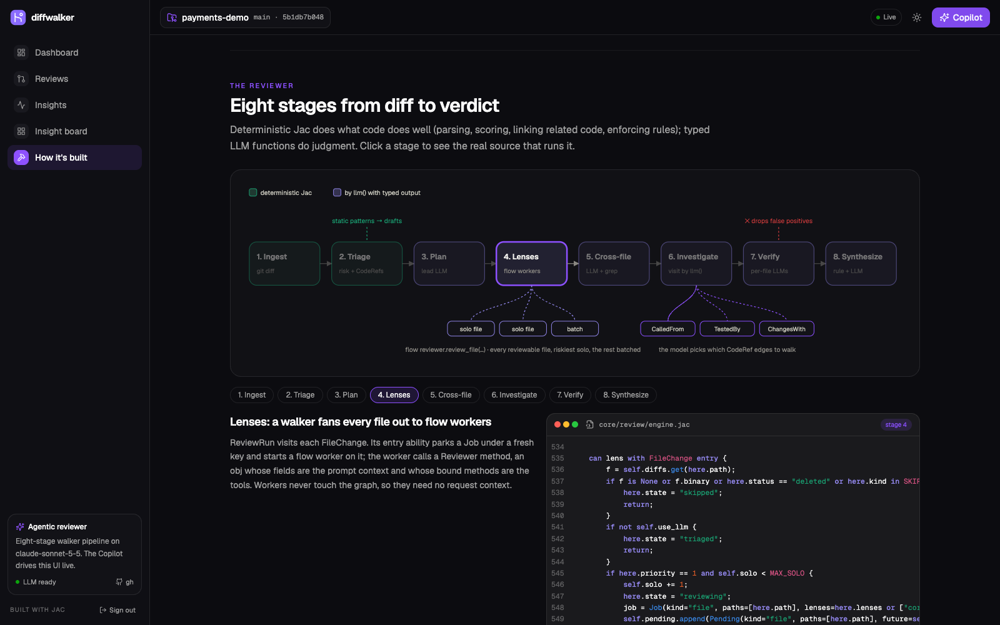</td>
<td>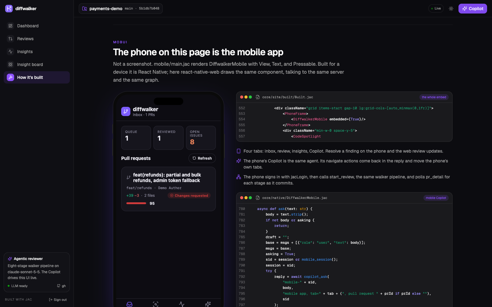</td>
</tr>
</table>

## How a review works

A review is a `Review` node with the pipeline's own graph under it:


`core/review/engine.jac` spawns the `ReviewRun` walker on a fresh `Review`. Its `Review` entry ability ingests, triages, and plans; its `FileChange` entry ability queues each file's reviewer, or adds the file to a batch of small ones; its `Review` exit ability, which fires after every file has been visited, runs the queued reviewers as `flow` tasks and does the rest. A review runs inside one long call, so the walker calls `commit()` (from `stdjac.graph`) as each stage finishes, and every open screen follows along.


1. **Ingest.** `git diff base...head` (or the worktree, or `gh pr diff`) is parsed into `FileDiff` / `Hunk` / `DiffLine` objects, including quoted and space-containing paths. GitHub PRs are fetched into `refs/diffwalker/pr/<n>` so reviewers read the PR's actual code.
2. **Triage.** A deterministic 0–100 risk per file from size, the repository's history hotspots, sensitive paths, new branching, missing tests, and word-bounded patterns for secrets, `eval`, `shell=True` and friends, plus `CodeRef` nodes for each file's callers, tests, and co-changing files.
3. **Plan.** `plan_review(...) -> ReviewPlan by llm()` infers the change's intent and assigns lenses and priority per file.
4. **Specialist lenses.** Every reviewable file is reviewed: priority-1 files on their own, the rest batched, each call a `flow` task. A review call is a `by llm()` function that takes a `Reviewer`, an `obj` whose fields are the prompt context and whose bound methods (`read_file`, `search_code`, `file_history`) are its tools: `tools=[r.read_file, r.search_code, r.file_history]`.
5. **Cross-file.** One agent hunts for broken callers and API drift across the whole change.
6. **Investigate.** For each flagged file an `Investigate` walker is spawned on its `FileChange`, and `visit [here --> [?:CodeRef]] by llm(select=(1, 3), intent=...)` lets the model choose which related code to read. Those excerpts become the verifier's evidence and are shown on each finding.
7. **Verify.** Drafts are anchored to commentable diff lines and deduplicated in code, then verified per file, eight drafts to a call, each call a `flow` task, keyed by draft id.
8. **Synthesize.** A typed `ReviewSummary` writes the prose. The verdict is recomputed from what survived: any high or critical finding means `request_changes`.

A `flow` of a call evaluates its arguments where it is written and runs the call on one of the runtime's threads, so the reviewers' and the verifiers' model calls overlap, and the walker takes each one's drafts as it finishes. Tasks only call the model; the walker alone touches the graph.

Typed outputs re-ask the model on a reply that does not fit. `stdjac.llm` reports the tokens of every request (`on_usage`); `core/review/meter.jac` bills them to their review and stage, prices them by its table of model rates, and tells a reviewer to wrap up once the review passes `DIFFWALKER_REVIEW_BUDGET`. Without a model key the deterministic stages still run and produce a verdict.

## How the Copilot works

`core/agent/copilot.jac` is a single `by llm()` function with 29 tools in four groups:

| Group | Tools |
|---|---|
| Drive the UI | `navigate`, `open_pull_request`, `focus_file`, `filter_findings`, `show_insights`, `notify`, `switch_repository` |
| Read the repository | `list_pull_requests`, `pull_request_details`, `file_diff`, `read_file`, `search_code`, `blame`, `repo_overview`, `hotspot_report`, `contributor_report`, `ownership_report`, `coupling_report`, `activity_report` |
| Change review state | `review_pull_request`, `post_comment`, `update_finding`, `reply_to_finding`, `list_findings`, `export_review`, `publish_to_github` |
| Render insights | `render_chart`, `render_table`, `render_diagram` (cards that pin to the board) |


- The function returns `Iterator[ByEvent]`, so the call is streamed: the model's words, each tool call and its result, and what each request used arrive as events. The `copilot_stream` endpoint turns them into frames, and the pane reads them with `async for`.
- Writes go through `core/actions.jac`, the same functions the buttons call, so Copilot can do anything you can.
- The tool calls of one round run at once (`parallelize=True`), each on its own thread with the turn's context. An action that writes holds a lock, so two that touch one finding apply in turn.
- The conversation is a typed `list[Message]` kept on the chat thread's node and passed as `conversation=history`. `trim_history` keeps its most recent whole turns once it passes 400,000 characters.
- A turn stops, between rounds, when you press Stop or when it passes `DIFFWALKER_TURN_BUDGET`.
- UI events are tagged with the user and the browser or CLI session. Each user's live stream carries only their own events, which is how the terminal can drive the same user's browser.
- Publishing to GitHub asks for confirmation in the UI. The `gh` call runs after the endpoint has returned, and a toast says how it went.

## Four apps, one codebase


[`archwire.jac`](archwire.jac) declares the spaces code runs in and the four apps made of them, over a shared `core/`:

```jac
graph spaces {
    space site: browser { entry web; pages.* | core.site.*; }
    space phone: hermes { entry mobile.main; }
    space api: native { core.api; }
    space cli: native { entry cli.main; }

    app web { run api; serve site; }
    app desktop { run site; }
    app mobile { run phone; }
    app cli { run cli; }
}

graph spaces local {
    app desktop { run site, api; }
}
```

- `site` is the pages in a browser, `phone` the React Native app, `api` the server, and `cli` the command-line program. The `local` profile is the desktop app with the server in its own program.
- `core/api.jac` is the only module of `api`. Everything else under `core/`, apart from `core/site/`, is in no space: it is compiled into each program that uses it. That is how the CLI runs a review in-process, and calls `core.api` over HTTP only with `--live`.
- A call across spaces, such as a page's `await pr_detail(id)`, is an ordinary typed call that the compiler sends to the server. What crosses is declared in `core/wire.jac`.
- An endpoint whose result is an `Iterator[T]` is a stream: `live` and `copilot_stream` are the two. A page reads one with `async for`, the CLI with `for`.
- Modules write no imports of each other. Every import is a wire in the archwire's `graph import` blocks.

| Command | Does |
|---|---|
| `neojac run web` | Builds the web app and runs it: the server, serving the site |
| `neojac dev web` | The same, rebuilding on every save |
| `neojac run desktop` | Builds the desktop app and opens its window |
| `neojac run cli -- <args>` | Builds the CLI and runs it with `<args>` |
| `neojac build mobile` | Builds the phone app: `dist/mobile/mobile.apk` and its bundles |
| `neojac run mobile` | Builds it, installs it on a connected Android phone or an emulator, and opens it |
| `neojac build` | Builds every app into `dist/`; `neojac build web cli` builds those two |

The artifacts are `dist/web-<platform>/web` (with the site in `pages/site/` beside it), `dist/desktop-<platform>/desktop`, `dist/cli-<platform>`, and `dist/mobile/mobile.apk`. They need nothing installed where they run. A program started outside the project finds the project's `.env` through `DIFFWALKER_HOME`.

## Configuration

Put secrets in `.env` (gitignored) or the environment.

| Variable | Default | Purpose |
|---|---|---|
| `ANTHROPIC_API_KEY` | | Key for Anthropic's Messages API, which `by llm()` calls |
| `ANTHROPIC_BASE_URL` | Anthropic's API | A gateway to that API, used in its place |
| `JAC_LLM_MODEL` | `[llm] model` in `jac.toml` (`claude-sonnet-5-5`) | The model `by llm()` asks. Anthropic models only. `core/review/meter.jac` holds the rates of the models it prices; a request to any other model shows as costing nothing |
| `DIFFWALKER_REPO` | the repo containing diffwalker | Default repository for new accounts, and for the CLI when `--repo` is not given |
| `DIFFWALKER_HOME` | the current directory | Where diffwalker's project is: its `.env`, and the source the "How it's built" page shows |
| `DIFFWALKER_REVIEW_BUDGET` | `2.0` | Dollars a review may spend before its reviewers are told to wrap up |
| `DIFFWALKER_REVIEW_DEADLINE` | `900` | Seconds from a review's start after which it stops waiting for its reviewers |
| `DIFFWALKER_TURN_BUDGET` | `0.75` | Dollar cap per Copilot turn |
| `DIFFWALKER_URL` | `[apps.cli.remote] api` in `jac.toml` (`http://127.0.0.1:8000`) | Server for CLI `login` and `--live` commands; `--server` overrides it |
| `DIFFWALKER_TOKEN` / `DIFFWALKER_PASSWORD` | | Non-interactive CLI auth: a session token for `--live`, a password for `login` |
| `JAC_WEB_LISTEN` | `127.0.0.1:8000` | The address the web app's server listens on, `host:port` |
| `JAC_WEB_DATA` | `.jac/data/web` in the project | Where the web app's server keeps its accounts and graph |
| `JAC_REMOTE_API` | `[apps.desktop.remote] api` in `jac.toml` | The server the desktop app's server mode connects to |

The server listens on `127.0.0.1` and is one process. It answers each call on a thread of its own, so a call that waits (for the model, for an event) holds no other up, and all of them share one graph in memory, written when a call returns and at each `commit()`. The live event log (`core/live.jac`) is in that process's memory. diffwalker runs `git` and `gh` against paths you give it; it is meant for local use, not for exposure on a network.

## Project layout

| Path | Contents |
|---|---|
| `archwire.jac` | The spaces and the four apps (`graph spaces`), and every import between modules as a wire (`graph import`) |
| `jac.toml` | Each app's deployment values, the model, the lint rules, the npm packages of the site and the phone app (`[npm.web]`, `[npm.mobile]`), and what the phone app's Android build is made with (`[android]`) |
| `core/api.jac` | Every endpoint (authenticated, plus a public `server_info`), including the two streams, `live` and `copilot_stream` |
| `core/wire.jac` | The typed shapes that cross between the server and its callers: views, live events, Copilot frames |
| `core/actions.jac` | Graph mutations shared by endpoints and Copilot tools |
| `core/graph.jac` | Nodes, typed edges with `sem` strings, per-user lookups, and the `CollectFindings` walker |
| `core/review/` | Risk triage, related-code context, reviewer agents, the walker pipeline, and the spend meter |
| `core/agent/copilot.jac` | The Copilot and its tools |
| `core/analytics.jac` | History mining: activity, hotspots, contributors, ownership, structure, coupling |
| `core/git/` | `git` / `gh` access and the unified-diff parser |
| `core/live.jac` | Per-user event log behind the `live` stream |
| `core/env.jac` | Where the project is, and its `.env` |
| `core/site/` | Web UI: sign-in, shell, Copilot pane, pages, review workspace, hand-built SVG charts, diagrams |
| `core/native/` | The phone app's component, shared by `mobile/` and the web page that embeds it |
| `core/site/desktop/` | The desktop app's mode and profile pickers, and the sidebar's switch |
| `pages/` | The site's routes, one page a file. The path and the `page` function's parameters make the route: `pages/reviews.jac` is `/reviews/:id` |
| `web.jac` | The browser entry: every page, behind the desktop app's pickers |
| `mobile/main.jac` | The phone app's entry |
| `cli/` | The command-line app |
| `eco/web/` | The site's bundler files (Vite, Tailwind). `neojac install` writes each npm tree's `package.json` to `eco/<tree>/` from `jac.toml` |
| `docs/demo/make-demo-repo.sh` | Builds the demo repository used in the screenshots |

Check each program as its build compiles it:

```bash
neojac check --app web --space api    # the server
neojac check --app cli                # the command-line app
neojac check --space site             # the pages
neojac check --space phone            # the phone app
neojac fmt <files>                    # format what you changed
```

`neojac docs <topic>` prints neojac's documentation for a word, a diagnostic code or a page (`neojac docs apps/crossings`), and `neojac skills` lists its playbooks.

## Notes on the neojac toolchain

diffwalker is written in the Jac that [neojac](https://github.com/marsninja/neojac) defines and is built with nothing else. Building it found defects and gaps in neojac. They are fixed there, not worked around here, and [DOGFOOD.md](DOGFOOD.md) records each one, fixed or still open. The limits that show today:

- `by llm()` is neojac's `stdjac.llm`, which calls Anthropic's Messages API. Only Anthropic models work.
- The desktop app's window exists for Linux only (GTK 3 with WebKitGTK 4.1).

What has been run: all four apps build. The web app, the CLI (in-process and `--live`) and the desktop app's two modes were run end to end against a scripted stand-in for the model API (`ANTHROPIC_BASE_URL`), driving the site in headless Chromium, and the web and desktop apps were stopped and started again on the data they kept. Against Anthropic's API (`claude-sonnet-5-5`), a full review ran from the server and from the command line, and the Copilot answered and drove the site, over the API and in its pane in headless Chromium. The phone app was installed on an Android emulator by `neojac run mobile` and used there against the same server and model: sign-in, the inbox, a review started from the phone with its stages arriving, its findings, insights, and a Copilot turn whose tool calls moved the phone's tabs.

## License

[MIT](LICENSE) © 2026 Jason Mars
